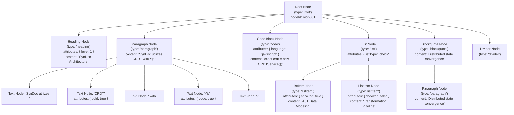

# SynDoc: Markdown to JSON (AST) Mapping & Layout Specification

This document presents the complete architectural layout diagrams, structural trees, mapping specifications, and schema definitions that bridge raw Markdown content and SynDoc's recursive Abstract Syntax Tree (AST) JSON database model.

---

## 1. Architectural Layout Pipeline

```
+-----------------------------------------------------------------------------------------+
|                                    RAW MARKDOWN INPUT                                   |
|   # SynDoc Collaboration Engine                                                         |
|   SynDoc uses **CRDT** and *recursive AST* to power real-time collaborative editing.    |
|   ```javascript                                                                         |
|   const doc = new SynDocSession({ docId: 'xyz' });                                      |
|   ```                                                                                   |
|   - Real-time updates                                                                   |
|   - [x] Pre-save change tracking                                                        |
+-----------------------------------------------------------------------------------------+
                                             │
                                             ▼
+-----------------------------------------------------------------------------------------+
|                               TOKENIZER & AST MAPPER                                    |
|   - Identifies Block Delimiters: Headings (#), Fenced Code (```), Lists (-, 1.), Quotes  |
|   - Identifies Inline Formatting: Bold (**), Italic (*), Code (`), Link ([]())          |
|   - Generates Unique UUIDv4 Node IDs (`nodeId`)                                         |
|   - Normalizes Attributes: `attributes.level`, `attributes.language`, `attributes.listType` |
+-----------------------------------------------------------------------------------------+
                                             │
                                             ▼
+-----------------------------------------------------------------------------------------+
|                                  SYNDOC RECURSIVE AST                                   |
|   {                                                                                     |
|     "nodeId": "root-uuid",                                                              |
|     "type": "root",                                                                     |
|     "children": [                                                                       |
|       { "type": "heading", "attributes": { "level": 1 }, "content": "..." },            |
|       { "type": "paragraph", "children": [ { "type": "text", "attributes": {...} } ] }, |
|       { "type": "code", "attributes": { "language": "javascript" }, ... },              |
|       { "type": "list", "attributes": { "listType": "bullet" }, "children": [...] }     |
|     ]                                                                                   |
|   }                                                                                     |
+-----------------------------------------------------------------------------------------+
                         │                                         │
                         ▼                                         ▼
+-------------------------------------------------+  +------------------------------------+
|               MONGODB ATLAS                     |  |         YJS CRDT REALTIME          |
|   - Stored in `Document.ast`                    |  |   - Synchronized via `Y.Array`     |
|   - Pre-save circular reference verification    |  |   - Granular block lock & merge    |
|   - Pre-save structural diffing & audit trail   |  |   - Ephemeral presence cursors     |
+-------------------------------------------------+  +------------------------------------+
```

---

## 2. Tree Hierarchy Layout Diagram



---

## 3. Detailed Markdown-to-JSON Mapping Table

| Markdown Syntax | AST Node `type` | Node `attributes` / `attrs` | Children Supported | Content Representation |
|:---|:---|:---|:---:|:---|
| `# H1` to `###### H6` | `'heading'` | `{ level: 1..6 }` | Yes (Inline text) | Full heading string |
| Paragraph text | `'paragraph'` | `{}` | Yes (Formatted inlines) | Full paragraph string |
| `**bold**` / `__bold__` | `'text'` | `{ bold: true }` | No | Bold text segment |
| `*italic*` / `_italic_` | `'text'` | `{ italic: true }` | No | Italic text segment |
| `` `code` `` | `'text'` | `{ code: true }` | No | Inline code segment |
| `~~strikethrough~~` | `'text'` | `{ strikethrough: true }` | No | Struck text segment |
| `[Label](URL)` | `'text'` | `{ link: 'URL' }` | No | Anchor link text segment |
| ```` ```lang ... ``` ```` | `'code'` | `{ language: 'lang' }` | No | Multi-line code string |
| `- item` or `* item` | `'list'` $\rightarrow$ `'listItem'` | `{ listType: 'bullet' }` | Yes (`listItem[]`) | Item string |
| `1. item` | `'list'` $\rightarrow$ `'listItem'` | `{ listType: 'ordered' }` | Yes (`listItem[]`) | Item string |
| `- [x] item` | `'list'` $\rightarrow$ `'listItem'` | `{ listType: 'check' }`, `{ checked: true }` | Yes (`listItem[]`) | Task label string |
| `> quote` | `'blockquote'` | `{}` | Yes (`paragraph[]`) | Quote string |
| `---` / `***` | `'divider'` | `{}` | No | Empty string |
| `` | `'image'` | `{ src: '...', alt: '...', caption: '...' }` | No | Alt text string |

---

## 4. Complete Mongoose Document JSON Schema

When transformed and saved in MongoDB, a document conforms to the following schema:

```json
{
  "_id": "66e6b8c9d2f34e1234567890",
  "title": "SynDoc Specification",
  "version": 1,
  "lastModifiedBy": "engineer@syncdoc.dev",
  "stats": {
    "nodeCount": 9,
    "wordCount": 24,
    "depth": 3
  },
  "ast": {
    "nodeId": "c3a1f948-289b-4ec5-b223-28f0814fba00",
    "type": "root",
    "content": "",
    "attributes": {},
    "metadata": {},
    "children": [
      {
        "nodeId": "48fceb4b-9703-4b95-89db-48df08da0901",
        "type": "heading",
        "content": "Collaborative AST Engine",
        "attributes": {
          "level": 1
        },
        "children": []
      },
      {
        "nodeId": "d67e7c85-2c81-4da2-817f-1d440ad81002",
        "type": "paragraph",
        "content": "Real-time state convergence via Yjs CRDT.",
        "attributes": {},
        "children": [
          {
            "nodeId": "8f03ec19-c12e-4bda-912b-b5bcad781003",
            "type": "text",
            "content": "Real-time state convergence via ",
            "attributes": {},
            "children": []
          },
          {
            "nodeId": "aa4b09b5-f852-47ef-8d63-bc6d68991004",
            "type": "text",
            "content": "Yjs CRDT",
            "attributes": {
              "bold": true
            },
            "children": []
          },
          {
            "nodeId": "f9011be7-0f8a-49f3-8321-df6be6aa1005",
            "type": "text",
            "content": ".",
            "attributes": {},
            "children": []
          }
        ]
      },
      {
        "nodeId": "73e9ebcf-9ca5-4089-a2e1-88fc40292006",
        "type": "code",
        "content": "const engine = new CRDTEngine();",
        "attributes": {
          "language": "javascript"
        },
        "children": []
      }
    ]
  },
  "changeHistory": [
    {
      "version": 1,
      "action": "CREATE",
      "summary": "Document \"SynDoc Specification\" created with AST (9 node(s), depth 3)",
      "stats": {
        "nodeCount": 9,
        "wordCount": 24,
        "depth": 3
      },
      "timestamp": "2026-09-17T18:15:00.000Z"
    }
  ]
}
```

---

## 5. Sanity Check Verifications

The companion test script `backend/verify_markdown_mapping.js` automatically executes and asserts 7 sanity checks:
1. **Headings Sanity**: Level bounds (1 to 6), attribute consistency, and content preservation.
2. **Inline Formatting Sanity**: Correct isolation of bold, italic, code, strikethrough, and links into child `text` nodes.
3. **Fenced Code Block Sanity**: Multi-line preservation, whitespace retention, language tagging.
4. **Lists Sanity**: Accurate partitioning of bullet lists, numbered lists, and task checkboxes (`checked: true/false`).
5. **Structural Integrity**: Full AST tree pass through `validateASTStructure` (no circular references, valid node types, max depth compliance).
6. **Round-Trip Fidelity**: Bidirectional conversion sanity (`Markdown` $\rightarrow$ `AST JSON` $\rightarrow$ `Markdown`).
7. **Mongoose Document Lifecycle**: Pre-save hook validation, metrics calculation (`nodeCount`, `depth`, `wordCount`), and audit history tracking.
